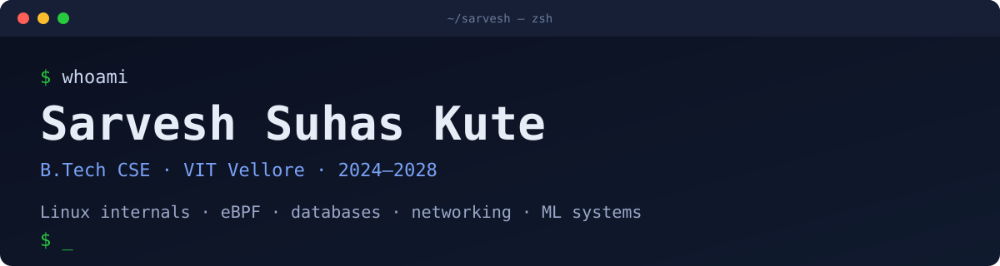

## About

Curious by nature, builder by habit. Most of my projects start with a question: how does a DNS server answer a query, how does Linux decide what to cache, how do you keep a seat from being booked twice.

- B.Tech Computer Science at VIT Vellore, 2024–2028, CGPA 9.36
- Software Engineering Intern at Supertech Instrumentation Services, May–Jul 2026: built 12 REST APIs and a React dashboard, cutting response time from 850 ms to 120 ms on 500,000+ rows of sensor data

## Selected work

<table>
<tr>
<td width="50%" valign="top">

### [RouteWise](https://github.com/sarveshsuhaskute/RouteWise)

Transport booking system on a 19-table BCNF MySQL schema with 30 triggers and atomic, row-locked seat booking. RBAC, CSRF protection and CI.

`Flask` `MySQL` `Docker` `GitHub Actions`

**257× faster queries after indexing**

</td>
<td width="50%" valign="top">

### [Linux File Prefetcher](https://github.com/sarveshsuhaskute/ai-file-prefetcher-)

Daemon that traces file access with eBPF, learns sequences with a Markov model and preloads files before they are read.

`Python` `BCC` `eBPF` `C`

**99.25% cache hit rate, matching kernel readahead**

</td>
</tr>
<tr>
<td width="50%" valign="top">

### [Network Service Platform](https://github.com/sarveshsuhaskute/network-service-platform)

Concurrent TCP/UDP server with SHA-256-verified file transfer and an RFC 1035 DNS server that works with `dig`. Caching, forwarding, load-testing dashboard.

`Python` `Sockets` `DNS`

**33 functional, fault-injection and security tests**

</td>
<td width="50%" valign="top">

### [CodeJury](https://github.com/sarveshsuhaskute/CodeJury) (team)

Local bug-repair system where two fixers, a critic and a judge debate a patch. Only executed, user-approved tests can reject a fix; otherwise it answers "unresolved".

`Python` `LoRA` `MLX` `LLMs`

**4 LoRA roles sharing one 4-bit Phi-4-mini**

</td>
</tr>
</table>

Also: [LLM Compiler Optimizer](https://github.com/sarveshsuhaskute/compiler-optimization-for-llm) (team), with 9 optimisation techniques on a computation-graph IR.

## Stack

